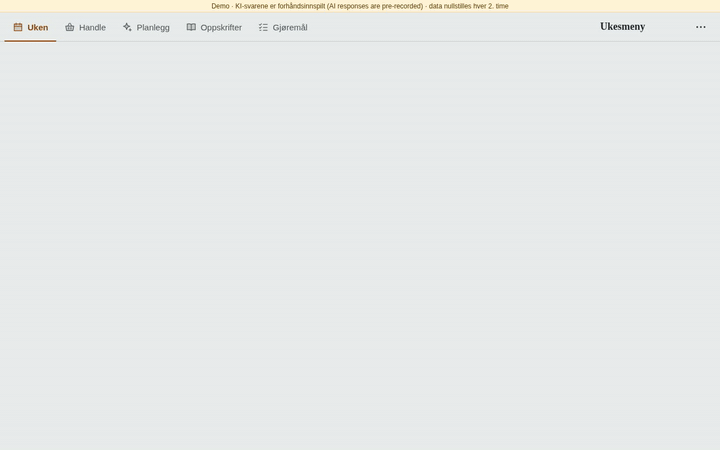
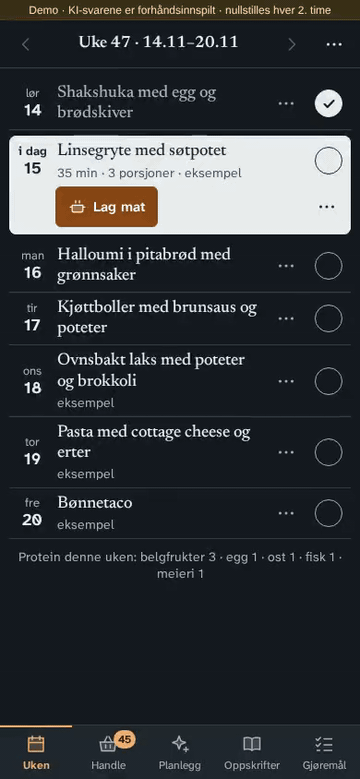
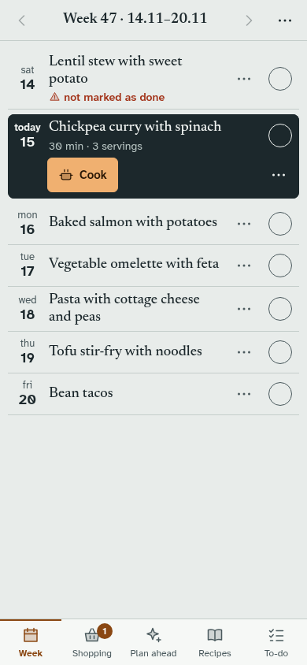
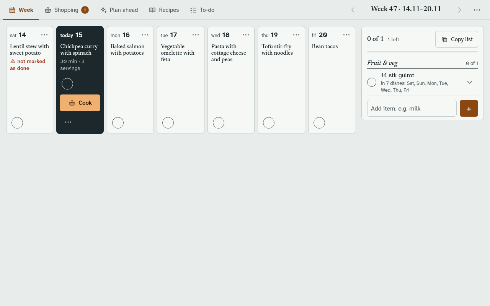

# Ukesmeny

A weekly dinner and shopping planner for a household, powered by a large language model.
Every week it proposes seven dinners that fit the family's preferences, writes the recipes, and turns them into one
merged shopping list sorted by store aisle. It's built for everyday use on a phone, shared by the whole family, and it
runs on a small home server.

<table>
  <tr>
    <td width="72%"></td>
    <td width="28%"></td>
  </tr>
  <tr>
    <td align="center">Desktop (<a href="docs/media/ukesmeny-demo.mp4">MP4</a>)</td>
    <td align="center">Phone, dark mode (<a href="docs/media/ukesmeny-demo-mobile-dark.mp4">MP4</a>)</td>
  </tr>
</table>

*About a minute each: a recipe written by the model, swapping a dish, the shopping list, cooking mode, and planning
next week, recorded in the public demo.*

## Live demo

**Try it: [mealplan-production-32a7e369.up.railway.app](https://mealplan-production-32a7e369.up.railway.app)** — AI responses are pre-recorded and the data resets every 2 hours.

The demo is the real app in demo mode: every AI answer you see is a real model response recorded once and replayed,
so the demo costs nothing to run and can't be used to spend anyone's subscription. Features that need the network or
API keys (store deals, prices, recipe import, photo reading) are switched off, and the shared demo data resets every
two hours. See [docs/DEMO.md](docs/DEMO.md) for how it works and how to deploy it.

<p align="center">
  
</p>



*Screenshots use demo data from the test model.*

## Features

- **Week planning with an LLM.** The model plans the week from household preferences, recent dinners (no repeats) and
  favourites. The server mixes in "home dishes" (cooked and liked before) and dishes from a curated inspiration
  database, so the model only invents a few new dishes a week. That keeps quality up and API calls down.
- **Balanced plates.** Every dinner needs a named protein source, vegetables and a filling side. The server estimates
  protein per serving from the recipe and asks the model for a targeted fix when a dish falls short.
- **Recipes in the background.** Recipes are written ahead in a queue while the week is still a draft, survive server
  restarts, and are reused instead of regenerated when a dish comes back.
- **One shopping list.** Ingredients from all dishes are merged into one row per product, with honest unit
  conversions (a stock cube = 5 dl, 1 dl rice = 85 g), sorted in store-aisle order, with check-offs synced between
  phones.
- **Child plan.** An optional child profile gets "the same" or a simpler dish of its own each day, with likes and
  dislikes, a fish limit and rules that the server checks after the model answers.
- **Recipe import.** From a link (schema.org/Recipe), a photo or pasted text; ingredients are copied verbatim and
  scaled in code.
- **Store deals and prices.** Weekly flyer deals from Coop Extra and KIWI (including PDF parsing) matched to list items
  by the model with server-side guards, and approximate dish prices from the Kassalapp API.
- **Public demo mode.** `LLM_BACKEND=demo` replays recorded model answers, blocks every outgoing HTTP call and resets a
  shared demo database on a timer, so the app can be shown publicly without a model, keys or costs.
- **More:** a cooking mode with large step-by-step text and Wake Lock, shared to-do lists, three UI languages
  (Norwegian, Polish, English), dark mode, and daily database backups with rotation.

## Tech stack

| Layer | Technology |
|---|---|
| Backend | Python 3.12, FastAPI, SQLite, Pydantic, httpx, pypdf |
| Frontend | Plain HTML, CSS and JavaScript (no framework, no build step), local fonts, SVG icons |
| LLM | Claude via the Claude Code CLI (`claude -p`), Sonnet for whole weeks and Haiku for small tasks; Gemini CLI as an option ([`app/llm.py`](app/llm.py)) |
| Deployment | Docker and Docker Compose on a home server |
| Testing | Python test scripts against a real server with a deterministic fake model; browser tests drive headless Chromium over CDP |

All model output is requested as JSON and validated on the server. Business rules (repeat filters, protein checks,
week composition, child-plan rules) live in code, not in the prompt alone.

## Project layout

```
app/
  app.py                    FastAPI app: API, planning logic, shopping list, background jobs
  llm.py                    Swappable LLM backend (Claude Code CLI, Gemini CLI, or demo replay)
  demo_fixtures/            Real model answers recorded for the demo
  demo_seed.db              Demo database with one planned week
  static/                   Frontend: index.html, app.js, app.css, i18n.js, fonts
  inspiracje.sample.json    Sample inspiration database
deploy/ukesmeny/            Dockerfile, docker-compose.yml, .env.example
deploy/demo/Dockerfile      Image for the public demo (no CLI, no secrets); render.yaml deploys it
tools/
  fakebin/claude            Deterministic fake model used by all tests
  test_*.py                 Tests (API, shopping list, import, backups, browser UI, demo mode)
  record_demo_video.py      Records the walkthrough above with Playwright
  inspiracje/               Scripts that build the inspiration database
```

## Running locally

```bash
cd app
python3 -m venv .venv
.venv/bin/pip install -r ../deploy/ukesmeny/requirements.txt

# With the real model (needs the Claude Code CLI, logged in):
DB_PATH=./data.db BACKUP_DIR=./backups .venv/bin/python -m uvicorn app:app --port 8000

# Or the demo (recorded answers, no account needed):
: > /tmp/demo.db && LLM_BACKEND=demo DB_PATH=/tmp/demo.db .venv/bin/python -m uvicorn app:app --port 8000

# Or with the fake model used by the tests:
PATH=$PWD/../tools/fakebin:$PATH DB_PATH=/tmp/ukes.db BACKUP_DIR=/tmp/ukes-bk \
  .venv/bin/python -m uvicorn app:app --port 8000
```

Then open http://localhost:8000.

Optional environment variables: `KASSAL_API_KEY` (prices), `KIWI_POSTCODE` (regional KIWI flyer),
`OFFER_DEFAULT_CHAINS` (set it empty to disable flyer fetching), `LLM_BACKEND`, `LLM_MODEL_BIG` and `LLM_MODEL_SMALL`.

## Tests

```bash
python3 tools/test_static.py                      # frontend: asset hashes, JS syntax, translation keys
PATH=$PWD/tools/fakebin:$PATH app/.venv/bin/python tools/test_shopping_merge.py
PATH=$PWD/tools/fakebin:$PATH app/.venv/bin/python tools/test_import.py
app/.venv/bin/python tools/test_demo.py           # demo mode: replay, no subprocess, no network, reset
```

Server-based tests start the app themselves on a temporary database (`UKES_PY`, `UKES_EMPTY_DB`, and `PLAN_MIX=0` for
the older ones). See [`CLAUDE.md`](CLAUDE.md) for details.

## Deploying

```bash
tools/make_deploy.sh                 # builds deploy/ukesmeny from app/ and packs deploy/ukesmeny.tar.gz
cd deploy/ukesmeny
cp .env.example .env                 # add CLAUDE_CODE_OAUTH_TOKEN (from `claude setup-token`)
docker compose up -d --build         # serves on port 8099
```

Data (database, backups, login) lives in the `./data` volume.

## Inspiration database

The full inspiration database (about 70 dinners collected from public Norwegian and Swedish recipe sites) is **not
included**, because its content belongs to those sites. The scripts that build it are in
[`tools/inspiracje/`](tools/inspiracje/). Without it the app uses a small sample written for this repository, and the
tests that depend on the full database skip.

## About

A personal project built with AI-assisted development (Claude Code). I designed the product and its rules, and I
directed, reviewed and tested the implementation. The commit history shows how the app evolved, feature by feature.
